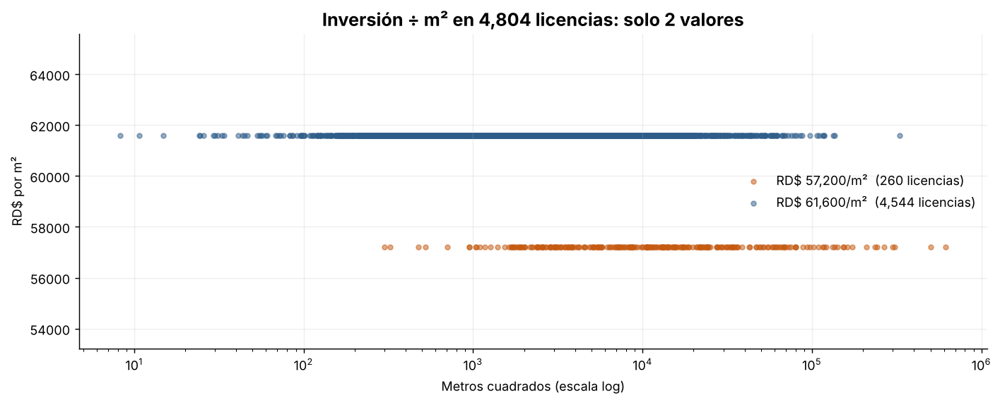
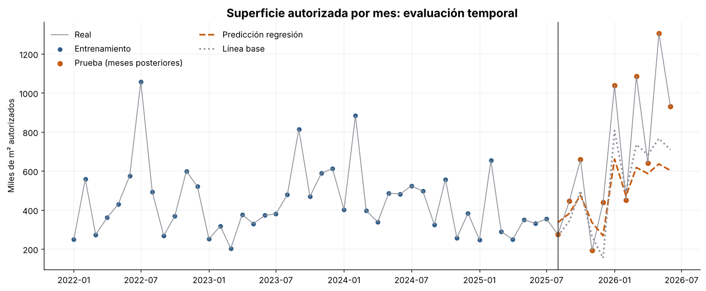

# Un R² de 0.999 que no significa nada

**Análisis de las licencias de construcción emitidas por el MIVHED (República Dominicana, 2022–2026)**

`Python` · `pandas` · `scikit-learn` · `matplotlib` · Datos abiertos de RD

---

## En 30 segundos

Una regresión lineal que estima la **inversión** de una obra a partir de sus **metros cuadrados** obtiene
**R² = 0.9986**. Parece un modelo casi perfecto, pero no lo es.

Al dividir la inversión entre la superficie en las 4,804 licencias válidas, el resultado toma **solo dos valores**:

| Tarifa | Licencias | % |
|---|---:|---:|
| RD$ 61,600 por m² | 4,544 | 94.6 % |
| RD$ 57,200 por m² | 260 | 5.4 % |



`Inversión Total` **no es un dato medido**: es `Metros Cuadrados × tarifa fija`. El modelo no aprendió
ninguna relación económica, solo redescubrió la fórmula con la que el ministerio calcula el campo. En
términos técnicos, es **fuga de información** (*data leakage*).

> **Lección:** un ajuste casi perfecto en datos administrativos es una hipótesis de fuga de información
> hasta demostrar lo contrario. Calcular el cociente Y/X y contar sus valores únicos toma treinta segundos.

## Segunda parte: evaluar bien un modelo con datos en el tiempo

Para tener una pregunta con variabilidad real, el análisis pasa al nivel **mensual**: ¿cuántos m² se
autorizan en un mes según el número de licencias emitidas? (54 meses, enero 2022 a junio 2026).

La versión original evaluaba este modelo con una **partición aleatoria** y obtenía R² = 0.58. Con una serie
de tiempo eso es un error: mezcla meses futuros en el entrenamiento y, con tan pocos datos, el resultado
depende del azar.

| Evaluación | R² |
|---|---:|
| Partición aleatoria (versión original, `random_state=42`) | 0.58 |
| La misma partición con 200 semillas distintas (90 % central) | de −1.39 a 0.62 |
| **Entrenar con el pasado, probar con ago-2025 a jun-2026** | **0.23** |
| Línea base: licencias del mes × m² promedio por licencia del pasado | **0.51** |



**Una regla simple supera a la regresión.** La línea base comete menos error en los meses de prueba
(≈ 187 mil m² frente a ≈ 230 mil m² de error medio) y gana en 3 de 4 ventanas de validación cruzada temporal.
El modelo mensual sirve como referencia de orden de magnitud, no como pronóstico.

## Limitaciones

- 54 meses es una serie corta, así que las conclusiones del modelo mensual son preliminares.
- En 2026 la superficie autorizada sube con fuerza respecto a los años anteriores. Ningún modelo entrenado
  solo con el pasado lo anticipa bien.
- No se usan variables como provincia, tipología o estacionalidad, que podrían explicar mejor la superficie.

## Créditos

Este análisis nació como **trabajo grupal** de la asignatura *Inteligencia Artificial I* de la Maestría en
Ciencia de Datos e Inteligencia Artificial, elaborado por el grupo **Los del Prompt**: Alejandra Espinal,
Erick Peña, Evans Gregorio, Lisbeth Pinales y Mariano Duran.

- **Del grupo:** el análisis original, el hallazgo de las dos tarifas y la propuesta del modelo mensual.
- **Mi aporte en esta versión (Mariano Duran):** la reestructuración como caso de estudio, la versión
  reproducible fuera de Google Colab y la **corrección de la evaluación del modelo mensual** (partición
  temporal, prueba de sensibilidad a la semilla, línea base y validación cruzada temporal).

## Cómo ejecutarlo

```bash
git clone https://github.com/marianoduran33-prog/licencias-mivhed-analisis.git
cd licencias-mivhed-analisis
pip install -r requirements.txt
jupyter notebook notebooks/analisis_licencias_mivhed.ipynb
```

El dataset está en `data/`. Si falta, el notebook intenta descargarlo de la fuente oficial.

## Estructura

```
├── data/          Dataset del MIVHED y su ficha de origen
├── figures/       Gráficos usados en este README (los genera el notebook)
├── notebooks/     Análisis completo, ejecutado y con resultados
└── requirements.txt
```

## Datos

[Licencias emitidas por el MIVHED, 2022–2026](https://datos.gob.do/dataset/licencias-emitidas), del Portal de
Datos Abiertos de la República Dominicana. Licencia **ODbL**. Versión actualizada al 21/07/2026.
